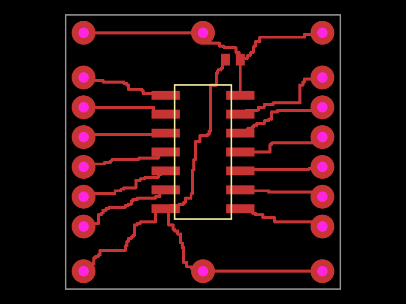

# @tscircuit/single-layer-grid-router

A single-copper-layer grid routing solver with a custom tscircuit `algorithmFn`.
Built with `@tscircuit/solver-utils` following the [handbook bootstrap guide](https://github.com/tscircuit/handbook/blob/main/guides/bootstrapping-repos.md).

## Use with tscircuit

```sh
bun add github:tscircuit/single-layer-grid-router
```

```tsx
import { algorithmFn } from "@tscircuit/single-layer-grid-router"

export default (
  <board width="20mm" height="20mm" layers={1} autorouter={{ algorithmFn }}>
    {/* components and traces */}
  </board>
)
```

For custom settings:

```ts
import { createSingleLayerGridAlgorithmFn } from "@tscircuit/single-layer-grid-router"

const algorithmFn = createSingleLayerGridAlgorithmFn({
  gridSize: 0.1, // mm
  clearance: 0.15, // copper edge to copper edge, mm
  layer: "top",
  maxAttempts: 16,
})
```

All terminals must lie on the selected layer. `layerCount` may describe a larger
physical stack, but this router still emits wires exclusively on one layer.
It never emits vias or jumpers. A failed solve emits an error rather than returning
partial routing. The adapter supports progress/complete/error listeners,
`start()`, `stop()`, and `solveSync()`.

## Solver and debugger

```ts
import { SingleLayerGridRouter } from "@tscircuit/single-layer-grid-router"

const solver = new SingleLayerGridRouter(simpleRouteJson)
solver.solve()
if (solver.failed) throw new Error(solver.error ?? "Routing failed")
const traces = solver.getOutput()
const graphics = solver.visualize()
```

Each solver step routes one branch. Connections with shared electrical terminals
or root aliases form one net; nearest-terminal tree branches are routed with
4-neighbor A*. Foreign pads, non-plated holes, and already routed copper block
cells. Conservative inflation covers the trace width, clearance, and the segments
between cells, including off-grid terminal connectors. Collinear points are removed.
When a route is blocked, the solver rips up its generated copper and retries a
different deterministic net order. Existing copper remains fixed.

Rectangular bounds, rotated rectangular obstacles, circular obstacles, and
pre-existing wire traces are supported. Runtime oval obstacles from tscircuit are
conservatively bounded by their rectangles. Polygon outlines and mixed-layer
terminals fail explicitly. This heuristic is not a complete planar router:
limited net-order retries or grid resolution can reject otherwise routable boards.
The default cell limit is 1,000,000; increase `gridSize` for large boards.

```sh
bun install
bun run start       # React Cosmos: open pages/74hc00.page.tsx
bun run build:site  # export the debugger
bun test
bun run typecheck
bun run format:check
```

Source TypeScript is exported directly (github-vanilla-style); no package build
step or committed lockfile is required. Configuration and CI originate from
`@tscircuit/plop` templates.

## 74HC00 regression board

The supplied screenshot is reconstructed in `tests/fixtures/74hc00-board.ts`:
SOIC-14 U1, decoupling capacitor C1, MC1–MC14 edge pads, and MP1–MP4 power pads.
Its electrical mapping preserves all twelve NAND gate signal pins, VCC, and GND.
The fixture uses an estimated 18.4mm square board, 1.27mm SOIC pitch, and 2mm edge
header pitch. These are documented estimates, not extracted fabrication dimensions.
Silkscreen gate symbols are not copper obstacles; routing under the SOIC body is
allowed, as shown in the screenshot.

Both the solver fixture and a real tscircuit board solve all **14 nets / 20 branches**
with no vias or jumpers. Tests independently check continuous trace-to-pad and
trace-to-trace clearance, board-edge clearance, electrical connectivity,
determinism, failure behavior, and adapter cancellation/restart.



Every test has a committed visual SVG snapshot. Test bodies stay small; fixture
construction and verification live in `tests/fixtures/*`. This requirement is
also documented in `AGENTS.md`.

## Repository provisioning

Created through [tscircuit/create-repo#96](https://github.com/tscircuit/create-repo/pull/96)
using `repos/single-layer-grid-router.yml`.
